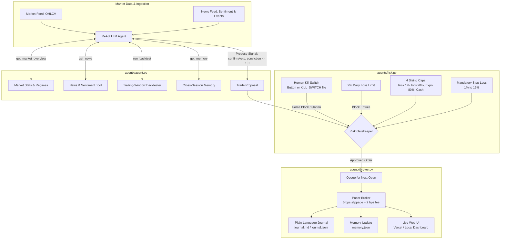

# AgentX Paper Trader — Team Aqvyn

[](https://www.python.org/)
[](https://opensource.org/licenses/MIT)
[](tests/)
[](https://teamaqvyn-frontend.vercel.app)
[](https://team-aqvyn.onrender.com)

> **Official Final Submission for AgentX Hackathon 2026**  
> **Track**: PS-02 · Agentic Trading Bot (Paper Trading)  
> **Team**: Team Aqvyn (Team Code: `884BC4`)

---

## 🚀 Live Demo & Deployment

| Resource | URL | Details |
|---|---|---|
| 🌐 **Live Web Dashboard** | [teamaqvyn-frontend.vercel.app](https://teamaqvyn-frontend.vercel.app) | Production web dashboard (Vercel) |
| 🐍 **Backend API Service** | [team-aqvyn.onrender.com](https://team-aqvyn.onrender.com) | FastAPI / HTTP SSE backend (Render) |
| ⚡ **Local One-Click Run** | [`RUN_LIVE_DEMO.bat`](RUN_LIVE_DEMO.bat) | Self-contained Windows live demo with real LLM |

> ⚠️ *Note: The free-tier Render backend spins down on inactivity. It may take ~30 seconds to wake on the initial request.*

---

## 💡 The Core Thesis

> *"Every AI trading bot shows you what it made. Ours shows what it was **not allowed** to do."*

**The LLM proposes; deterministic code disposes.**

Language models hallucinate, misread numbers, and suffer from emotional volatility. Giving an LLM raw API access to place trades is catastrophic. 

In AgentX:
1. **The LLM is an Analyst**: It reads prices and news, backtests candidate strategies dynamically, evaluates qualitative context, and writes plain-English explanations.
2. **Deterministic Code is the Gatekeeper**: The model has **ZERO execution authority**. Position sizing, stop-losses, daily loss limits, and a human kill switch live in plain Python that no model output can override.
3. **Adversarial Safety**: In our test suite (`test_llm_cannot_enlarge_or_bypass_risk`), a hostile model demanding 100x leverage is shut down by the gatekeeper.

---

## 🏗️ System Architecture



---

## ⚡ Quickstart Guide

### 1. Local One-Click Demo (Windows)
Double-click [`RUN_LIVE_DEMO.bat`](RUN_LIVE_DEMO.bat) to launch the full live demo with your model gateway and automatically open the local dashboard at `http://localhost:8765`.

### 2. Manual Setup (Any OS)
```bash
# Clone the repository
git clone https://github.com/rugvedjavheri06-dev/Team_Aqvyn.git
cd Team_Aqvyn

# Install dependencies (only NumPy is required!)
pip install -r requirements.txt

# Run the local dashboard (offline stub model, zero lag)
python -m agentx.dashboard

# Run a full multi-day CLI simulation session -> outputs to ./out/
python -m agentx.run_demo

# Run the 30-market robustness Monte Carlo evaluation
python -m agentx.robustness --markets 30

# Run all 26 automated unit tests
python -m unittest discover -s tests -t .
```

### 3. Connecting a Live LLM (Gemini, Groq, DeepSeek, OpenAI, Ollama)
1. Copy `.env.example` to `.env`.
2. Configure your OpenAI-compatible endpoint:
   ```env
   AGENTX_LLM_BASE_URL=https://api.runinfra.ai/v1
   AGENTX_LLM_API_KEY=your_api_key_here
   AGENTX_LLM_MODEL=deepseek-v4-1-flash-1017
   ```
3. Test connectivity and model reasoning:
   ```bash
   python -m agentx.check_llm
   ```
4. Run the dashboard or demo with live HTTP inference:
   ```bash
   python -m agentx.dashboard --llm http
   ```

---

## 📋 PS-02 Compliance Matrix

| Hackathon Requirement | Where It Lives | Implementation Details |
|---|---|---|
| **Reads market data & news** | [`agentx/tools.py`](agentx/tools.py) | `get_market_overview` (volatility, trend, RSI), `get_news` (sentiment score -1 to +1). |
| **Selects & adapts strategy via backtesting** | [`agentx/agent.py`](agentx/agent.py)<br>[`agentx/backtest.py`](agentx/backtest.py) | ReAct loop periodically backtests candidates (`sma_crossover`, `rsi_mean_reversion`, `breakout`, `risk_off`) on trailing data before selecting. |
| **Paper trading account only** | [`agentx/broker.py`](agentx/broker.py)<br>[`agentx/config.py`](agentx/config.py) | `PAPER_ONLY = True`, `LIVE_TRADING_ENABLED = False`. In-memory broker with 5 bps slippage and 2 bps transaction fees. |
| **Position sizing & stop-losses** | [`agentx/risk.py`](agentx/risk.py) | Sizing bounded by the minimum of 4 caps: 1% equity risk budget, 20% single position, 80% gross exposure, available cash. Mandatory stop-loss (1%–15%). |
| **Daily loss limit** | [`agentx/risk.py`](agentx/risk.py) | When intraday drawdown hits -2%, all new entry orders are strictly blocked. |
| **Human kill switch** | [`agentx/risk.py`](agentx/risk.py)<br>[`agentx/dashboard.py`](agentx/dashboard.py) | One-click button in UI or creating a `KILL_SWITCH` file. Cancels pending entries instantly, with optional next-open position flattening. Exits always allowed. |
| **Plain-language trade journal** | [`agentx/journal.py`](agentx/journal.py) | Logs every execution, reason, worst-case risk, AND why skipped trades were vetoed to `journal.md` and `journal.jsonl`. |
| **Benchmark comparison** | [`agentx/report.py`](agentx/report.py)<br>[`agentx/session.py`](agentx/session.py) | Real-time mark-to-market comparison against equal-weight Buy-and-Hold benchmark; outputs `equity_curve.svg` and markdown reports. |
| **Cross-session memory** | [`agentx/memory.py`](agentx/memory.py) | Persists strategy performance across sessions; prompts agent to distrust strategies with poor historical win rates. |

---

## 📊 Empirical Robustness (30-Market Monte Carlo)

Rather than cherry-picking a lucky seed, we evaluated AgentX across **30 independent synthetic markets** (310 trading days each, 60-day warmup) using `python -m agentx.robustness --markets 30`:

```
Robustness over 30 synthetic markets (310 days each):
- Agent: mean +2.81%, median +1.30%, positive in 18/30 markets
- Buy-and-hold: mean +13.46%, median +7.62%, positive in 21/30 markets
- Rising markets (21): agent +4.53% vs buy-and-hold +24.22%
- Falling markets (9):  agent -1.20% vs buy-and-hold -11.65%
- Max Drawdown:         agent -5.6%  vs buy-and-hold -15.6% (Mean)
```

### Key Takeaways:
1. **Capital Preservation in Bear Markets**: When markets decline, the agent lost only **-1.2%** vs Buy-and-Hold's **-11.7%**.
2. **Drawdown Protection**: Mean maximum drawdown was reduced by **nearly two-thirds** (-5.6% vs -15.6%).
3. **Intentional Bull-Market Lag**: Because the system enforces a strict 20% cash reserve and caps single positions at 20%, it underperforms raw Buy-and-Hold in roaring bull markets. This is by design: our value is **disciplined, explainable risk control**, not reckless speculation.

---

## 🛡️ Production Engineering & Failure Modes

Built with enterprise reliability principles:
* **Circuit Breaker**: If the LLM gateway fails 3 consecutive times (`fail_limit = 3`), the circuit breaker trips (`self.offline = True`), preventing API hangs.
* **Graceful Rule Fallback**: If an LLM call times out or returns malformed JSON, the engine automatically falls back to deterministic rule-based execution at **half size** (conviction = 0.5) and records the incident in `journal.md`.
* **Required Tool Enforcement**: When tested against real LLMs, models occasionally claimed "no news" without calling `get_news`. In [`agent.py`](agentx/agent.py), the runner inspects called tools and **bounces any final answer** that skipped required tools.
* **Non-Blocking UI Concurrency**: In [`dashboard.py`](agentx/dashboard.py), the trading loop runs on a background daemon worker thread. The UI never freezes while an LLM is thinking; `/api/state` and the human kill switch respond in `< 10ms`.
* **Zero Lookahead Bias**: Decisions occur strictly at the day's Close ($t$); fills execute at next day's Open ($t+1$). Stop-losses are evaluated against day $t+1$'s Low.

---

## 📁 Repository Structure

```
Team_Aqvyn/
├── agentx/                    # Core Python Agentic Trading Engine
│   ├── agent.py               # ReAct planning loop, required tool enforcement & circuit breaker
│   ├── backtest.py            # Trailing-window backtest engine
│   ├── broker.py              # In-memory paper broker with slippage & transaction fees
│   ├── check_llm.py           # Connectivity and reasoning validation script
│   ├── config.py              # System settings (LIVE_TRADING_ENABLED = False)
│   ├── dashboard.py           # Multi-threaded HTTP API & dashboard server
│   ├── data.py                # Synthetic market generator & CSV price reader
│   ├── journal.py             # Plain-language trade & rejection journal
│   ├── llm.py / stub_llm.py   # OpenAI-compatible HTTP client & offline fallback stub
│   ├── memory.py              # Cross-session strategy win-rate memory
│   ├── metrics.py             # Sharpe ratio, drawdown, profit factor, win rate
│   ├── report.py              # Markdown report & SVG equity curve generators
│   ├── risk.py                # Deterministic Risk Gatekeeper (4 caps, stop-loss, kill switch)
│   ├── robustness.py          # 30-market Monte Carlo robustness evaluation
│   ├── run_demo.py            # CLI session runner
│   ├── session.py             # Chronological daily loop (no lookahead bias)
│   ├── strategies.py          # Technical strategies (SMA, RSI, Breakout, Risk-Off)
│   ├── tools.py               # Read-only tool definitions for the ReAct agent
│   └── ui.html                # Built-in live browser dashboard
├── frontend/                  # Deployed Web UI (Vercel)
│   ├── index.html             # Responsive trading terminal interface
│   └── vercel.json            # Vercel deployment configuration
├── tests/                     # 26 Automated Unit Tests (100% Pass)
│   ├── test_core.py           # Core agent, broker, data, and adversarial risk tests
│   ├── test_dashboard.py      # Non-blocking dashboard & kill switch concurrency tests
│   └── test_http_llm.py       # Gateway, model parsing, and network failure tests
├── Procfile & runtime.txt     # Cloud deployment configuration (Render)
├── RUN_LIVE_DEMO.bat          # One-click Windows live demo launcher
├── RUN_E2E_CHECK.bat          # End-to-end verification script
└── README.md                  # System documentation & compliance matrix
```

---

## 👥 Team Aqvyn
* **Team Code**: `884BC4`
* **Members**: Rugved Javheri, Yash Jakkanwar, R. N., S. D.
* **Submission Portal**: [Hack4Hack AgentX Hackathon 2026](https://hack4hack.com/)
